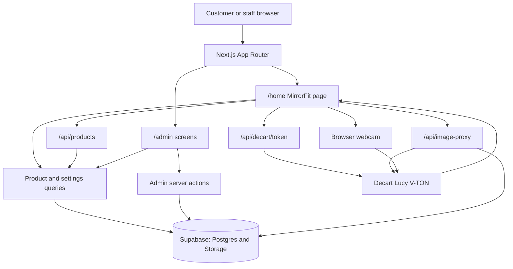

# MirrorFit — Virtual Dressing Room

MirrorFit is a touchscreen-friendly virtual dressing room for a boutique. Customers browse garments, preview themselves with a webcam, and can connect to Decart's Lucy V-TON AI try-on service. Staff can manage the product catalogue, collections, and mirror settings.

## Project at a glance

- **Customer experience:** `/home` is the MirrorFit experience. It displays active categories and up to five garments per page.
- **Try-on:** The browser requests camera access. When Decart is configured, the app connects to its real-time AI stream; without a working Decart key, the app stays in demo mode and shows the local camera feed.
- **Administration:** `/admin` contains the overview, catalogue, category, and MirrorFit settings screens.
- **Data:** Supabase provides PostgreSQL, authentication/storage libraries, and garment image storage. Sample categories and settings are used if reads fail; the local sample product list is empty.
- **Navigation and rendering:** The admin navigation shell persists between admin pages, while Next.js prefetches linked routes. MirrorFit caches recently viewed category pages in memory and memoizes stable product UI to avoid unnecessary renders.
- **Runtime:** Next.js App Router application, run with Node.js 20+ and npm.

## How the app works



### Customer MirrorFit flow

1. Visiting `/` redirects to `/home`. The server loads categories, the first page of products (maximum five), and MirrorFit settings.
2. The customer starts the camera and selects a garment. Camera access is requested by the browser; category and page changes load through `/api/products`.
3. The client asks `/api/decart/token` for a short-lived Decart token. The permanent `DECART_API_KEY` stays on the server. The garment image can be fetched through `/api/image-proxy` for AI processing.
4. With a valid token and successful connection, the client uses the transformed AI stream. Otherwise, it remains in demo mode and does not label the untransformed camera image as an AI result.
5. Camera/AI resources are stopped when the fitting session ends or the app is idle. Recording, when supported by the browser, is handled in the client and is limited in code to five minutes; it is not uploaded to the server.

### Administration flow

1. Staff sign in at `/admin/login`. The server checks credentials configured through environment variables and sets a signed, HTTP-only session cookie.
2. Protected admin pages and every admin server action verify the session before reading or changing data. The session expires after eight hours; use **Sign out** to clear it.
3. `/admin` loads catalogue, categories, and MirrorFit settings for the dashboard. Staff can create products, change publish/featured status, delete products, manage categories, and update settings. Product and setting writes use server actions backed by Supabase; image uploads use the `garment-images` Storage bucket.
4. Successful product writes revalidate the admin catalogue and customer MirrorFit paths so updated catalogue data is displayed.

> **Access-control warning:** The app's admin routes and server actions require the signed admin session, but `0002_public_admin_access.sql` grants anonymous and authenticated Supabase users broad write access to catalogue, settings, and garment-image storage. A user with the public Supabase key can bypass the app UI and call Supabase directly. Do not deploy with real data until these policies are replaced with restrictive policies and reviewed.

## Folder structure

```text
app/
  admin/                  Admin dashboard, sign-in, products, categories, settings
  api/
    admin/login/          Admin credential check and signed session cookie
    admin/logout/         Admin session cookie deletion
    decart/token/         Server endpoint for short-lived Decart client tokens
    image-proxy/          Fetches approved remote garment images for the client
    products/             Paginated MirrorFit product-data endpoint
  home/                   Customer dressing-room page
  mirrorfit/              MirrorFit route alias that redirects to /home
  globals.css             Global styles and Tailwind theme
  layout.tsx              Root layout, fonts, and page metadata
  page.tsx                Redirect from / to /home
components/
  admin/                  Admin shell, product/category/settings forms and controls
  mirrorfit/              Camera, gallery, try-on, session, and recording UI
hooks/
  useMirrorFitSession.ts  Session timer, idle reset, and timeout callbacks
  useScreenRecording.ts   Browser MediaRecorder, replay, and local download
  useVirtualTryOn.ts      Webcam and Decart real-time try-on lifecycle
lib/
  decart/                 Server token creation and try-on prompt helpers
  products/               Supabase reads/writes, validation, sample data
  supabase/               Server-side Supabase client factory
types/
  database.ts             Product, category, settings, and try-on TypeScript types
supabase/
  migrations/             Database schema and later access-policy changes
  seed.sql                Example categories, garments, and MirrorFit settings
public/                   Static files served directly by Next.js
.github/workflows/ci.yml  GitHub Actions lint, type-check, and build job
```

## Routes

| URL | Purpose |
|---|---|
| `/` | Redirects to `/home` |
| `/home` | Customer MirrorFit virtual dressing room |
| `/mirrorfit` | MirrorFit route alias to `/home` |
| `/kiosk` | Legacy URL permanently redirects to `/mirrorfit` |
| `/admin/login` | Admin sign-in |
| `/admin` | Admin overview |
| `/admin/products` | Product catalogue, filters, and publish/feature controls |
| `/admin/products/new` | Create a garment and upload its image |
| `/admin/products/[id]` | Edit an existing garment |
| `/admin/categories` | Category management |
| `/admin/settings` | MirrorFit and shop settings |
| `/api/products` | Paginated catalogue JSON; accepts `categoryId`, `page`, and `pageSize` |
| `/api/admin/login` | Checks configured admin credentials and sets a signed session cookie |
| `/api/admin/logout` | Clears the admin session and redirects to sign-in |
| `/api/decart/token` | GET/POST endpoint that reports Decart availability and issues a client token |
| `/api/image-proxy` | Retrieves images from the allow-listed image hosts |

## Technology stack and dependencies

Versions below are the direct dependencies declared by `package.json`; the lockfile pins the complete dependency tree.

### Typography

The shared UI uses Inter for body text, navigation, buttons, and product names; Playfair Display is reserved for editorial and section headings.

| Element | Font | Weight | Size |
|---|---|---:|---:|
| Hero heading | Playfair Display | 600 | 48–64 px |
| Section heading | Playfair Display | 600 | 32–40 px |
| Product name | Inter | 600 | 16–20 px |
| Body text | Inter | 400 | 16–17 px |
| Buttons | Inter | 500–600 | 14–16 px |
| Navigation | Inter | 500 | 14–15 px |

### Application dependencies

| Package | Declared version | Role |
|---|---:|---|
| `next` | `16.4.1` | App Router, server rendering, route handlers, and server actions |
| `react`, `react-dom` | `19.3.0` | UI and client component runtime |
| `@supabase/supabase-js` | `^2.117.3` | Supabase database, auth, and storage client |
| `@supabase/ssr` | `^0.12.7` | Supabase browser/server clients with cookie support |
| `@decartai/sdk` | `^0.2.11` | Decart real-time AI try-on client |
| `zod` | `^4.6.7` | Validation for product, category, and settings data |
| `lucide-react` | `^1.57.0` | UI icon components |

### Styling, build, and development dependencies

| Package | Declared version | Role |
|---|---:|---|
| `tailwindcss` | `^4` | Utility-first CSS |
| `@tailwindcss/postcss` | `^4.3.3` | Tailwind CSS PostCSS integration |
| `typescript` | `^5` | Type checking and TypeScript compilation |
| `eslint` | `^9` | Linting |
| `eslint-config-next` | `16.4.1` | Next.js ESLint rules |
| `@types/node` | `^20` | Node.js type definitions |
| `@types/react`, `@types/react-dom` | `^19` | React type definitions |

## Getting started

### Requirements

- Node.js 20 or newer
- npm
- A Supabase project for persistent catalogue data and image uploads
- A Decart API key for live AI try-on (optional; without it, MirrorFit uses demo mode)

### Install and configure

In PowerShell from the project folder:

```powershell
npm ci
Copy-Item .env.example .env.local
```

Edit `.env.local` and set the Supabase URL and browser publishable/anonymous key. Set the optional server-only keys only if those features are needed.

| Variable | Required? | Purpose |
|---|---|---|
| `NEXT_PUBLIC_SUPABASE_URL` | Yes for Supabase data | Supabase project URL |
| `NEXT_PUBLIC_SUPABASE_PUBLISHABLE_KEY` | Yes for Supabase data | Preferred browser-safe key |
| `NEXT_PUBLIC_SUPABASE_ANON_KEY` | Alternative | Legacy/browser-safe key used if the publishable key is not set |
| `ADMIN_LOGIN_USERNAME` | Yes for admin sign-in | Admin username |
| `ADMIN_LOGIN_PASSWORD` | Yes for admin sign-in | Admin password; keep it in `.env.local` or deployment secrets |
| `ADMIN_SESSION_SECRET` | Yes for admin sign-in | Random signing secret of at least 32 characters; generate one with `node -e "console.log(require('crypto').randomBytes(32).toString('hex'))"` |
| `DECART_API_KEY` | Optional | Server-only permanent key used to mint short-lived Decart client tokens |

Never expose admin credentials or `DECART_API_KEY` with a `NEXT_PUBLIC_` prefix or commit real secrets. Use a unique, strong admin password for production.

### Set up Supabase

1. In the Supabase SQL Editor, run migrations `0001_initial_schema.sql`, `0002_public_admin_access.sql`, and `0003_rename_kiosk_settings_to_mirrorfit.sql` in order.
2. Review `0002_public_admin_access.sql` before running it. It deliberately changes access policies to allow public writes; this is unsafe for production.
3. Run `supabase/seed.sql` to add example categories, garments, and MirrorFit settings.
4. Confirm the `garment-images` bucket and its policies are appropriate for your deployment.

Migration `0003` renames the existing settings table to `mirrorfit_settings` without discarding its data. The first two migration files retain their original SQL history; their old table identifier is needed so existing installations can safely apply the rename.

## Run and validate

```powershell
npm run dev
```

Open `http://localhost:3000`. Camera access requires user permission and a secure context (localhost is allowed; deployed sites should use HTTPS).

| Command | What it does |
|---|---|
| `npm run dev` | Start the local Next.js development server |
| `npm run lint` | Run ESLint |
| `npx tsc --noEmit` | Type-check without emitting JavaScript |
| `npm run build` | Create a production build |
| `npm run start` | Serve the production build (run after `npm run build`) |

GitHub Actions runs lint, TypeScript type-checking, and a production build on pushes and pull requests to `main` or `master`.

## Notes and known limitations

- AI try-on requires a valid `DECART_API_KEY`, working Decart service access, browser camera permission, and a supported browser/device. Missing credentials or connection failures use demo mode.
- Browser recording uses the MediaRecorder API and a temporary browser-local Blob URL. Browser codec support varies; the current implementation caps a recording at 300 seconds.
- MirrorFit reads session and idle durations from Supabase settings (seed defaults: 30 seconds and 60 seconds).
- The later `0002` migration replaces several admin-oriented RLS policies with public write policies. See the access-control warning above.
- An AI-generated try-on is a visual preview, not a guarantee of exact fit, tailoring, or fabric physics.
